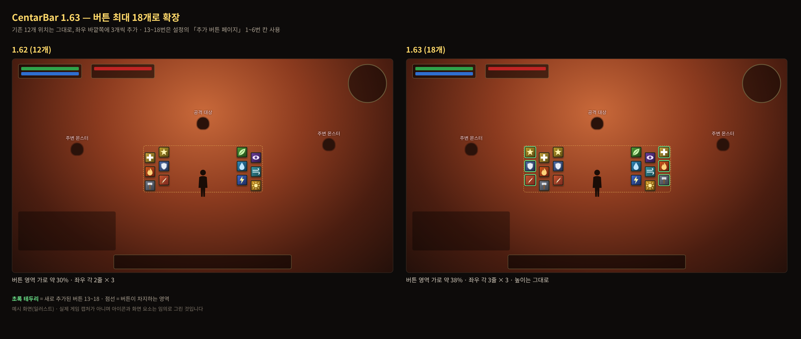
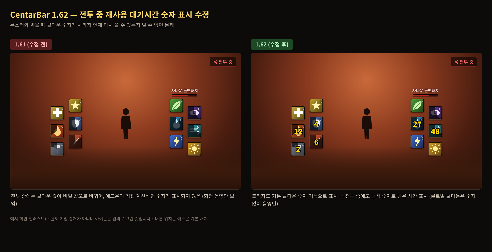
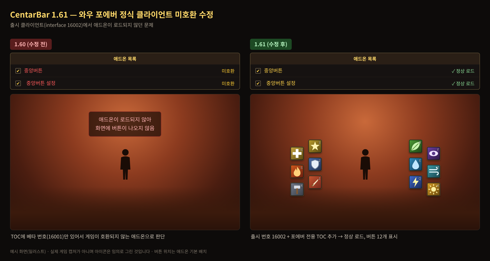

# 변경 내역

## 1.66 — 2026-11-13

- 설정창 「외형 모양 (템플릿)」 아래에 **표시 개수**(6개 / 12개 / 18개) 선택 추가 (#13)
  - 18개: 전체, 12개: 1~12번, 6개: 좌우 안쪽 줄(1~3번 + 7~9번)
  - 표시하지 않는 버튼은 숨기고 단축키 연결도 건너뜀. 위치·아이템은 그대로 남아서 개수를 다시 늘리면 돌아옴
  - 기본값은 18개(기존 동작 유지). 설정창의 미리보기 격자에도 반영되고 「설정 적용」에서 저장

## 1.65 — 2026-11-13

- 1.63 파일을 기존 설치 위에 덮어쓴 직후 13~18번 버튼이 기존 버튼과 겹치던 문제 수정 (#11)
  - 원인: 12칸 저장값에 13~18번 위치를 사용자 배치와 상관없이 고정 좌표로 채워 넣음
  - 이제 내 기존 배치의 바깥쪽(13~15 왼쪽, 16~18 오른쪽)에 겹치지 않게 놓고, 1.63에서 이미 겹친 채 저장된 위치도 다시 배치함 (직접 옮겨 둔 위치는 그대로)
- 13~18번 버튼에서 아이템을 빼면 기본 화면의 오른쪽 액션바 아이템과 같이 바뀌던 문제 수정 (#12)
  - 원인: 13~18번 기본 페이지가 3페이지(오른쪽 액션바와 같은 칸)였음
  - 기본 페이지를 10페이지로 변경. 1.63 기본값(3페이지) 그대로 쓰던 경우 자동으로 10페이지로 옮겨지며, 3페이지에 올려 둔 13~18번 아이템은 다시 올려야 함
  - 설정창 「추가 버튼(13~18) 페이지」에서 직접 바꾸면 그 값을 따름

## 1.64 — 2026-11-13

- 물약 같은 아이템을 올려둔 버튼을 눌러도 사용되지 않던 문제 수정 (기술·매크로 버튼은 변경 없음)
  - 원인: 포에버에는 전역 `GetItemInfo`가 없어 아이템 이름 대신 아이템 ID 숫자가 버튼에 들어갔고, 보안 버튼은 그 숫자를 장비 칸 번호로 해석해 엉뚱한 칸을 찾다가 실패함
  - 아이템을 항상 `item:<ID>` 형식으로 넘기도록 변경 → 아이템 캐시·언어와 상관없이 동작

## 1.63 — 2026-11-13

- 버튼을 최대 **18개**로 확장 (기존 12개 + 좌우 바깥쪽에 3개씩)
  - 기존 12개의 위치와 설정은 그대로 유지, 새 버튼 13~18은 기본 위치에 자동 추가
  - 13~18번은 설정창의 **「추가 버튼(13~18) 페이지」**에서 고른 액션바 페이지의 1~6번 칸을 사용 (기본값: 3페이지)
  - 설정창의 4가지 외형 템플릿과 대칭 이동(13↔16, 14↔17, 15↔18)도 18개에 맞게 확장
  - 단축키 설정 화면에 "중앙버튼 1~18" 이름으로 표시
- 단축키 연결 함수가 비어 있던 문제 수정: 단축키 설정 화면에서 지정한 키가 해당 버튼을 누르도록 연결 (전투 중 변경은 전투가 끝난 뒤 반영)
- 본체 폴더에 중복으로 들어 있던 `CentarBar_Option.lua` 제거 (설정창은 `CentarBar_Option` 애드온 하나만 사용)

## 1.62 — 2026-11-08

- 몬스터와 전투 중에 재사용 대기시간 숫자가 사라지던 문제 수정
  - 원인: 포에버(Midnight 기반)는 전투 중 쿨다운 값을 비밀 값(secret value)으로 넘겨주는데, 애드온이 그 값을 직접 비교·계산하다 실패해 숫자가 표시되지 않음
  - 숫자를 블리자드 기본 쿨다운 숫자 기능으로 표시하도록 변경 (`C_ActionBar.GetActionCooldownDuration` → `SetCooldownFromDurationObject`)
  - 기존 디자인(20pt 외곽선, 골드색) 유지, 글로벌 쿨다운 중에는 숫자 숨김
  - 직접 계산하던 타이머와 주문별 쿨다운 목록 제거 → 모든 직업에 동일하게 적용
  - 충전 횟수·소모품 개수, 아이콘 색상·체크 상태 판정도 전투 중 오류 없이 동작하도록 수정

## 1.61 — 2026-11-07

- 와우 포에버 정식 클라이언트에서 애드온 목록에 **미호환**으로 표시되어 로드되지 않던 문제 수정
  - TOC의 Interface 번호에 출시 클라이언트 번호 `16002` 추가 (기존 `16001`은 베타 번호)
  - 포에버 전용 TOC(`CentarBar_Forever.toc`, `CentarBar_Option_Forever.toc`) 추가

## 1.60

- 원본 (Clamp, zico)
