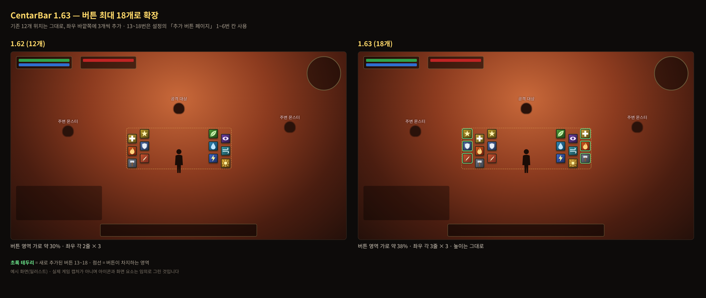
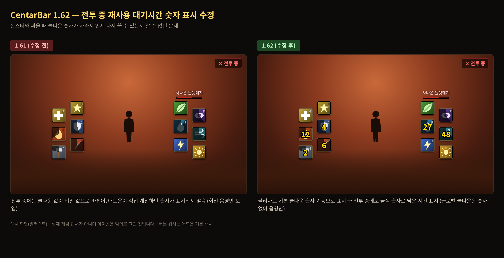
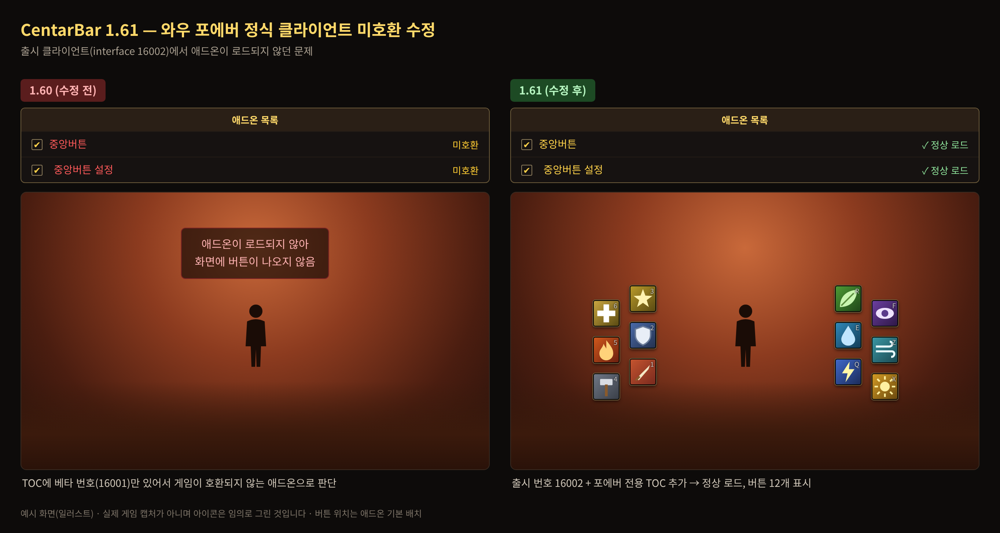

# 중앙버튼 (CentarBar) — Forever 대응판

화면 가운데에 액션 버튼을 최대 18개 만들어 주는 애드온입니다. 와우 포에버 정식 클라이언트에서 동작하도록 수정했습니다.

- **원작:** Clamp, zico
- **Forever 대응 수정:** @hyveo

## 버전별 변경 화면 (예시)

**1.63** — 버튼 최대 18개로 확장

**1.62** — 전투 중 재사용 대기시간 숫자가 사라지던 문제 수정

**1.61** — 포에버 정식 클라이언트에서 미호환으로 로드되지 않던 문제 수정

## 구성

| 폴더 | 역할 |
|---|---|
| `CentarBar` | 본체 (버튼 18개, 단축키) |
| `CentarBar_Option` | 설정 창 |

두 폴더를 모두 `Interface\AddOns\` 에 넣어야 합니다.

## 명령어

`/cbo`, `/cb`, `/centarbar`, `/센타`, `/중앙바` — 설정 창 열기

단축키: 게임 메뉴 → 단축키 설정 → 애드온 → 중앙버튼 (중앙버튼 1~18)

## 버튼과 액션바 페이지

| 버튼 | 사용하는 칸 |
|---|---|
| 1~12 | 설정창 「특성1/특성2 페이지」에서 고른 페이지의 1~12번 칸 |
| 13~18 | 설정창 「추가 버튼(13~18) 페이지」에서 고른 페이지의 1~6번 칸 (기본 3페이지) |

다른 액션바에 이미 보이는 페이지를 고르면 같은 기술이 두 곳에 나타납니다. 쓰지 않는 페이지를 고르는 것을 권장합니다.

## 문제가 생기면

- 애드온 목록에 **미호환**이 뜨면: 게임에서 `/dump select(4, GetBuildInfo())` 결과 번호를 알려주세요 (TOC의 Interface 번호 문제).
- 오류가 나면: `/console scriptErrors 1` 입력 후 다시 재현하고 오류 문구를 이슈로 남겨주세요.

변경 내역은 [CHANGELOG.md](CHANGELOG.md)를 참고하세요.

## 라이선스

이 폴더의 원본 코드는 Clamp, zico가 만든 것으로, 라이선스 없이 공개되었습니다.
hyveo가 와우 포에버용으로 수정한 부분만 [MIT 라이선스](../../LICENSE)입니다.
원본 코드의 모든 권리는 원작자에게 있으며, 원작자가 요청하면 내립니다.

The original code in this folder is by Clamp and zico, released with no license.
Only hyveo's WoW Forever changes are under the [MIT License](../../LICENSE).
The original authors keep all rights to their code, and it will be taken down if they ask.
