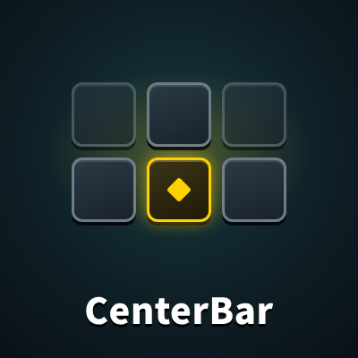

# 센터바 (CenterBar)

캐릭터 양옆에 액션 버튼을 최대 18개 놓아 주는 와우 포에버 애드온입니다. 시선을 화면 가운데에 둔 채로 기술을 쓸 수 있어요.

- **만든 사람:** @hyveo
- **소스 / 버그 제보:** https://github.com/hyveo/wow-forever-addons ([이슈 남기기](https://github.com/hyveo/wow-forever-addons/issues))

## 기능

- 버튼 6 / 12 / 18개 중 선택 (캐릭터에서 가까운 열부터 늘어남)
- 특성마다 다른 액션바 페이지 사용 (버튼 1~12), 버튼 13~18은 따로 고른 페이지의 1~6번 칸
- 보이기 방식: 항상 / 전투 중에만 / 마우스를 올렸을 때만
- 크기, 투명도, 버튼 간격, 캐릭터와 거리 조절
- 위치 잠금 해제 후 드래그로 옮기기
- 버튼 툴팁 끄기
- 단축키 지정 (게임 메뉴 → 단축키 설정 → 애드온 → 센터바)
- 재사용 대기시간·충전 횟수·사용 가능 여부는 게임 기본 액션 버튼과 같은 방식으로 표시

## 명령어

| 명령어 | 동작 |
|---|---|
| `/센터바`, `/centerbar`, `/cbar` | 설정 창 열기 |
| `/센터바 잠금` (`lock`) | 위치 잠금/해제 |
| `/센터바 초기화` (`reset`) | 위치와 설정을 처음으로 |
| `/hv cb` | hyveo 애드온 센터가 있으면 여기서도 열림 |

## 알아두기

- 다른 액션바에 이미 보이는 페이지를 고르면 같은 기술이 두 곳에 보여요. 기본값은 특성 페이지 7, 추가 페이지 10이에요.
- 전투 중에 바꾼 설정은 전투가 끝나면 적용돼요 (게임 보안 규칙).
- 예전 "중앙버튼" 계열 애드온과 함께 켜면 버튼이 겹칠 수 있으니 하나만 켜 주세요.

## 문제가 생기면

[GitHub 이슈](https://github.com/hyveo/wow-forever-addons/issues)에 아래 내용을 함께 남겨주세요.

- 애드온 목록에 **미호환**이 뜨면: 게임에서 `/dump select(4, GetBuildInfo())` 결과 번호
- 오류가 나면: `/console scriptErrors 1` 입력 후 다시 재현한 오류 문구
