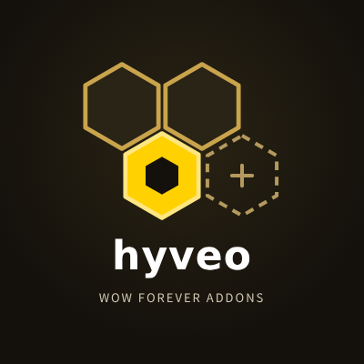

# hyveo 애드온 센터 (HyveoCenter)

hyveo가 만든 와우 포에버 애드온을 게임 안에서 한 창으로 관리하는 애드온입니다.

- **만든 사람:** @hyveo
- **소스 / 버그 제보:** https://github.com/hyveo/wow-forever-addons ([이슈 남기기](https://github.com/hyveo/wow-forever-addons/issues))

## 받는 곳

- **CurseForge (추천):** <https://www.curseforge.com/wow/addons/hyveo-addon-center-hyveo> — CurseForge 앱에서 게임 버전을 WoW Forever로 맞추고 `hyveo 애드온 센터`로 검색해도 나와요.
- **zip:** [Releases](../../../../releases)에서 `HyveoCenter-버전.zip`을 받아 `Interface\AddOns\`에 넣어요.
- **베타 (새 기능 먼저 써 보기):** 새 버전은 베타로 먼저 올라오고, 게임에서 확인이 끝나면 정식으로 바뀌어요. CurseForge 앱에서 이 애드온의 Release Type을 **Beta**로 바꾸거나(내 애드온 목록에서 오른쪽 클릭), CurseForge 페이지의 Files 탭에서 **B** 표시가 붙은 파일을 받으세요.

## 할 수 있는 것

- 레벨페이스, 센터바가 설치·켜짐 상태인지, 몇 버전인지 한눈에 보기
- 애드온 켜기/끄기 (적용하려면 [지금 다시 불러오기])
- 각 애드온 창 바로 열기
- 빠른 설정
  - 레벨페이스: 정보 바 보이기, 정보 바 잠금 (바로 적용)
  - 센터바: 전투 중에만 보이기, 마우스를 올렸을 때만 보이기 (바로 적용)
- 설치 안 된 애드온은 받는 곳 주소 복사
- 버그 제보 주소 복사

## 명령어

hyveo 애드온은 `/hv` 하나로 다 열 수 있어요. 각 애드온의 원래 명령어도 그대로 동작합니다.

| 명령어 | 동작 | 원래 명령어 |
|---|---|---|
| `/hv` | 센터 열기/닫기 | `/hyveo` |
| `/hv lp` | 레벨페이스 창 | `/lp` |
| `/hv cb` | 센터바 설정 창 | `/cb` |
| `/hv errors` (`오류`) | 오류 기록 창 (세 애드온 공통) | `/cb errors`, `/lp errors` |
| `/hv help` | 명령어 목록 | |

## 여는 방법

| 방법 | |
|---|---|
| 명령어 | `/hv`, `/hyveo`, `/하이브`, `/애드온센터` |
| 미니맵 옆 애드온 메뉴 | 목록에서 **hyveo 애드온 센터** 클릭 |
| 게임 설정 | ESC → 설정 → 애드온 → hyveo 애드온 센터 → [센터 열기] |

## 언어

English, 한국어, Deutsch, Español (América Latina / España), Français, Português, Русский, 简体中文, 繁體中文를 지원해요. 센터 왼쪽의 **언어**에서 고르면 센터바·레벨페이스도 같은 언어를 써요 (기본값은 "자동" = 게임 언어, 바꾸면 UI 다시 불러오기).

Spotted a bad translation? Please open a [GitHub issue](https://github.com/hyveo/wow-forever-addons/issues). Strings live in `HyveoCenter/Locales.lua`.

번역이 어색하거나 틀린 곳은 [GitHub 이슈](https://github.com/hyveo/wow-forever-addons/issues)로 알려 주세요.

## 알아두기

- 게임 안에서 새 애드온을 내려받을 수는 없습니다 (와우 애드온은 인터넷에 접속할 수 없음). 설치는 CurseForge 앱이나 [Releases](../../releases)에서 하세요.
- 레벨페이스는 1.0.1 이상에서 빠른 설정이 동작합니다.

## 문제가 생기면

[GitHub 이슈](https://github.com/hyveo/wow-forever-addons/issues)나 [CurseForge 페이지](https://www.curseforge.com/wow/addons/hyveo-addon-center-hyveo)의 댓글에 아래 내용을 함께 남겨주세요.

- **오류가 나면**: 게임에서 `/hv errors`를 입력하면 오류 기록 창이 열려요. 애드온 센터 창의 **오류 기록** 버튼으로도 열려요. `Ctrl+A`, `Ctrl+C`로 복사해서 GitHub 이슈나 CurseForge 댓글에 붙여 넣어 주세요.
  - hyveo 애드온(센터바, 레벨페이스, 애드온 센터)에서 난 오류를 자동으로 적어 둔 기록이에요. 오류 창을 켜 두지 않아도 남아요.
  - 캐릭터·서버·계정 이름은 들어가지 않아요. 애드온 버전, 게임 버전, 시각, 오류 문구만 있어요.
  - 로그아웃하거나 리로드하면 `WTF\Account\<계정>\SavedVariables\HyveoCenter.lua` 파일에도 저장돼요.
- **애드온 목록에 미호환이 뜨면**: 게임에서 `/dump select(4, GetBuildInfo())` 결과 번호

If something breaks: type `/hv errors` in game, press `Ctrl+A` then `Ctrl+C` in the window that opens, and paste it into a [GitHub issue](https://github.com/hyveo/wow-forever-addons/issues) or a comment on the [CurseForge page](https://www.curseforge.com/wow/addons/hyveo-addon-center-hyveo). The log holds addon and game versions, time and the error text. It has no character, realm or account names.
