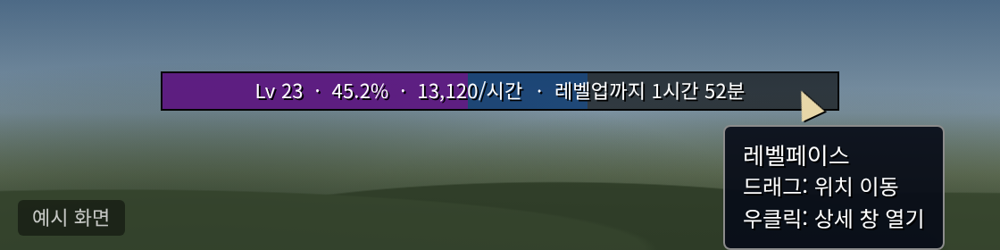
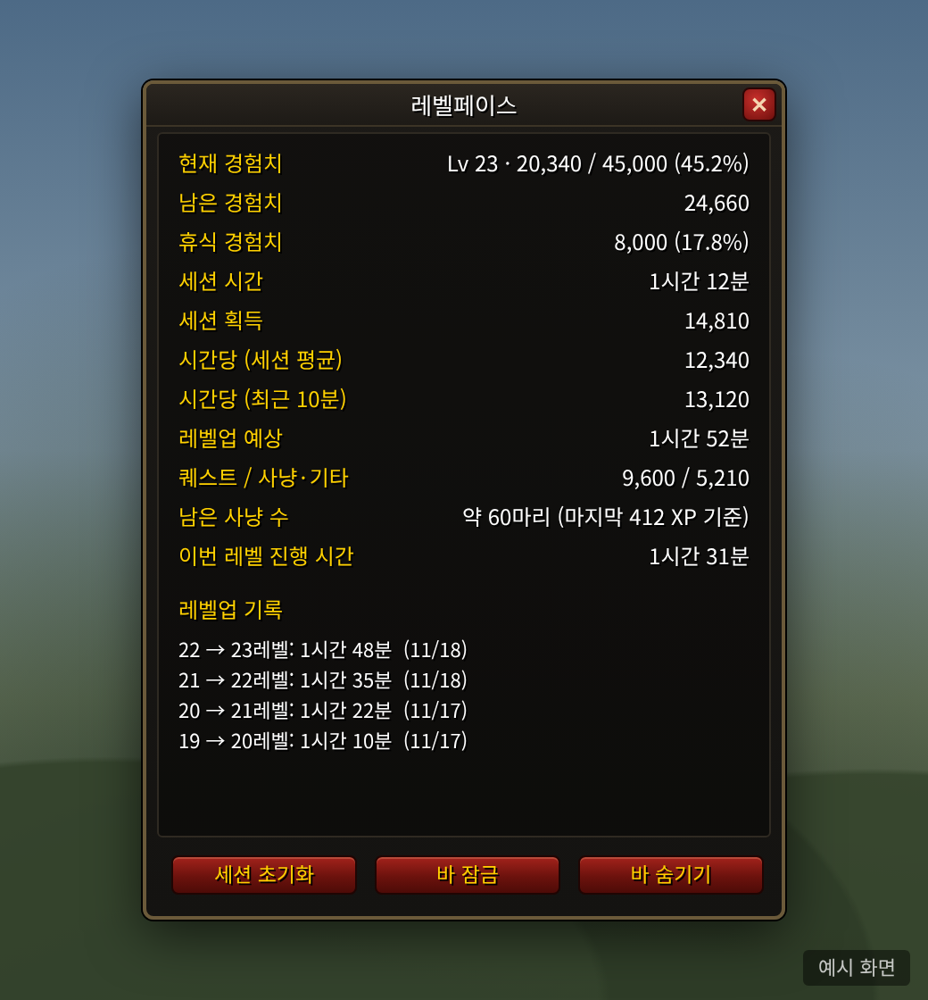

# 레벨페이스 (LevelPace)

와우 포에버용 레벨링 도우미입니다. 시간당 경험치와 레벨업까지 남은 시간을 화면 위 작은 바와 상세 창으로 보여줍니다.

- **만든 사람:** @hyveo
- **소스 / 버그 제보:** https://github.com/hyveo/wow-forever-addons ([이슈 남기기](https://github.com/hyveo/wow-forever-addons/issues))

## 받는 곳

- **CurseForge (추천):** <https://www.curseforge.com/wow/addons/levelpace> — CurseForge 앱에서 게임 버전을 WoW Forever로 맞추고 `레벨페이스`로 검색해도 나와요.
- **zip:** [Releases](../../../../releases)에서 `LevelPace-버전.zip`을 받아 `Interface\AddOns\`에 넣어요.
- **베타 (새 기능 먼저 써 보기):** 새 버전은 베타로 먼저 올라오고, 게임에서 확인이 끝나면 정식으로 바뀌어요. CurseForge 앱에서 이 애드온의 Release Type을 **Beta**로 바꾸거나(내 애드온 목록에서 오른쪽 클릭), CurseForge 페이지의 Files 탭에서 **B** 표시가 붙은 파일을 받으세요.

## 기능

**정보 바** — 화면 위쪽에 떠 있는 한 줄짜리 바

- 보라색: 현재 경험치, 파란색: 휴식 경험치
- 드래그로 위치 이동, 우클릭으로 상세 창 열기

**상세 창** — `/lp`로 열고 닫기 (Esc로도 닫힘)

| 항목 | 내용 |
|---|---|
| 현재 / 남은 / 휴식 경험치 | 이번 레벨 진행 상황 |
| 세션 시간 · 세션 획득 | 접속한 뒤로 얻은 경험치 |
| 시간당 경험치 | 세션 평균과 최근 10분 두 가지 |
| 레벨업 예상 | 최근 10분 속도 기준 (기록이 부족하면 세션 평균) |
| 퀘스트 / 사냥·기타 | 경험치를 어디서 얻었는지 |
| 남은 사냥 수 | 마지막으로 잡은 몹 경험치 기준으로 몇 마리 남았는지 |
| 이번 레벨 진행 시간 | 접속해 있던 시간만 계산, 로그아웃해도 이어짐 |
| 레벨업 기록 | 최근 레벨별로 걸린 시간 |

## 명령어

| 명령어 | 동작 |
|---|---|
| `/lp`, `/레벨`, `/레벨페이스` | 상세 창 열기/닫기 |
| `/lp 바` (`bar`) | 정보 바 보이기/숨기기 |
| `/lp 잠금` (`lock`) | 정보 바 잠금/해제 |
| `/lp 초기화` (`reset`) | 세션 기록 초기화 |
| `/lp 미니맵` (`minimap`) | 미니맵 버튼 보이기/숨기기 |
| `/lp 오류` (`errors`) | 오류 기록 창 열기 |

미니맵 버튼: 왼쪽 클릭 = 상세 창, 오른쪽 클릭 = 정보 바 보이기/숨기기, 드래그로 위치 이동.

## 언어

English, 한국어, Deutsch, Español (América Latina / España), Français, Português, Русский, 简体中文, 繁體中文를 지원해요. hyveo 애드온 센터에서 고른 언어를 따라가고, 센터가 없으면 게임 언어로 나와요.

Spotted a bad translation? Please open a [GitHub issue](https://github.com/hyveo/wow-forever-addons/issues). Strings live in `LevelPace/Locales.lua`.

번역이 어색하거나 틀린 곳은 [GitHub 이슈](https://github.com/hyveo/wow-forever-addons/issues)로 알려 주세요.

## 알아두기

- 설정과 레벨업 기록은 캐릭터별로 저장됩니다.
- "사냥·기타"에는 몹 처치 말고도 탐험 경험치 등 퀘스트가 아닌 경험치가 모두 들어갑니다.
- 최대 레벨에서는 바에 "최대 레벨"만 표시됩니다.

## 문제가 생기면

[GitHub 이슈](https://github.com/hyveo/wow-forever-addons/issues)나 [CurseForge 페이지](https://www.curseforge.com/wow/addons/levelpace)의 댓글에 아래 내용을 함께 남겨주세요.

- **오류가 나면**: 게임에서 `/lp errors`를 입력하면 오류 기록 창이 열려요. `Ctrl+A`, `Ctrl+C`로 복사해서 GitHub 이슈나 CurseForge 댓글에 붙여 넣어 주세요.
  - hyveo 애드온(센터바, 레벨페이스, 애드온 센터)에서 난 오류를 자동으로 적어 둔 기록이에요. 오류 창을 켜 두지 않아도 남아요.
  - 캐릭터·서버·계정 이름은 들어가지 않아요. 애드온 버전, 게임 버전, 시각, 오류 문구만 있어요.
  - 로그아웃하거나 리로드하면 `WTF\Account\<계정>\SavedVariables\LevelPace.lua` 파일에도 저장돼요.
- **애드온 목록에 미호환이 뜨면**: 게임에서 `/dump select(4, GetBuildInfo())` 결과 번호

If something breaks: type `/lp errors` in game, press `Ctrl+A` then `Ctrl+C` in the window that opens, and paste it into a [GitHub issue](https://github.com/hyveo/wow-forever-addons/issues) or a comment on the [CurseForge page](https://www.curseforge.com/wow/addons/levelpace). The log holds addon and game versions, time and the error text. It has no character, realm or account names.
